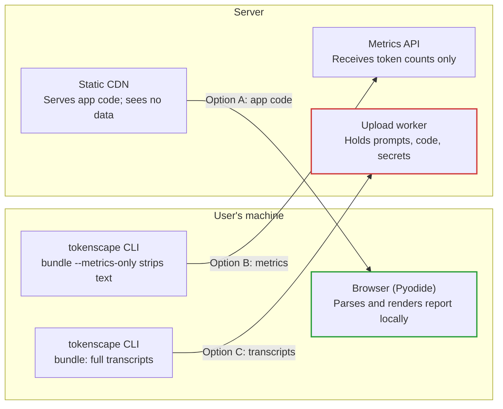

# tokenscape Web Service — Design Doc

Oct 11, 2026 · David Scheiderman

## Summary

Recommendation: offer tokenscape on the web as a **browser-only app** first, with analysis running client-side so session data never leaves the user's machine. A hosted upload service should come later, and only for **metrics-only bundles**.

The analysis pipeline already accepts a zip (`full-report --source bundle.zip --html-output`), so the web surface is a thin wrapper. The real cost is data security: session transcripts contain prompts, source code, command output and often secrets. Two code changes are prerequisites for any option: removing the module-level monkeypatch in `bundle.py` and hardening zip extraction.

## Background

tokenscape (v0.3.1 on PyPI) is a CLI and TUI that reads AI-assistant session transcripts from local disk. It needs no API keys or proxy.

| Input | Source | Code |
| --- | --- | --- |
| Claude Code sessions | `~/.claude/projects/` + macOS desktop sessions | `config.py`, `parser.py` |
| Codex CLI sessions | `~/.codex/sessions/` | `codex_parser.py` |
| Shared bundle | zip made by `tokenscape bundle`, read with `--source` | `bundle.py` |

`tokenscape bundle` zips every Claude `.jsonl` transcript into `projects/` and `desktop-sessions/` folders. `full-report --source <zip>` extracts it to a temp dir and produces markdown and/or a self-contained HTML report. Optional extras are semantic clustering (fastembed, about 150MB plus a 130MB model) and LLM-written AI Insights (`--summarize`, configured in `~/.config/tokenscape/config.toml`).

## Goals and non-goals

**Goals**

- Let a user get the tokenscape HTML report without installing Python.
- Accept the existing `tokenscape bundle` zip unchanged.
- Keep sensitive transcript content out of anyone else's hands, the operator's included, wherever possible.
- Reuse the existing analysis code rather than fork it.

**Non-goals (for now)**

- Long-term storage of user data or reports.
- Team dashboards that combine several users' data (a possible later phase).
- Live sync from a user's machine.
- Replacing the CLI/TUI.

## Threat model

A sessions zip is among the most sensitive files a developer has. Any service that receives one becomes a high-value breach target.

**What the data contains.** The raw `.jsonl` files hold full prompts, model responses, file contents read or written, and shell commands with their output. Even the parsed `Turn` record (`types.py`) keeps `user_text`, `bash_inputs`, `edited_files` and `cwd`. In practice that includes:

- API keys, tokens and `.env` contents pasted into chats or printed by commands
- proprietary source code and internal hostnames, paths and project names
- personal data from whatever the user was working on

| Threat | Applies to | Mitigation |
| --- | --- | --- |
| Server breach exposes uploaded transcripts | Hosted upload | Don't hold data: process in memory, keep no copies, or don't upload at all |
| Operator or insider access | Hosted upload | Browser-only processing; otherwise strict access controls and audit logs |
| Data mixed between users | Hosted upload | Per-request isolation; remove the shared global and shared caches |
| Zip bomb or path traversal | Any server parsing zips | Size and count caps; reject non-`.jsonl` entries and unsafe paths |
| Third-party LLM sees transcripts (AI Insights) | Any option with `--summarize` | Off by default; user-supplied key; scrub secrets first |
| Data left in logs or crash dumps | Hosted upload | No request-body logging; scrub error reports |
| Company policy forbids upload | All hosted options | Browser-only or metrics-only option |

## Required code changes

Five changes are needed before any web option. The first two also make the CLI more robust, so they are worth doing regardless.

| # | Change | Where | Needed for |
| --- | --- | --- | --- |
| 1 | Pass the list of session files into `stream_turns` / `stream_sessions` explicitly. Today `source_context` swaps out the module-level `parser_mod._iter_session_files`, so two requests running at once would read each other's files. | `bundle.py:58`, `parser.py:131` | All options; critical for a server |
| 2 | Harden zip reading: cap total uncompressed size and file count, accept only `.jsonl`, reject absolute or `..` paths, and preferably stream entries from the zip without `extractall`. | `bundle.py:44` | All options |
| 3 | Make the cache location configurable or disable caching per run. Embeddings, labels and summaries are written to `~/.cache/tokenscape` and would be shared across users. | `semantic.py:16-18` | Hosted options |
| 4 | Pass the LLM provider config in per request instead of reading `~/.config/tokenscape/config.toml`. | `cli.py:706-711`, `report.py:203` | Any option offering AI Insights |
| 5 | Add Codex support to `bundle` and `--source`, which today handle Claude only. | `bundle.py`, `codex_parser.py` | Feature parity |

A sixth, optional change: a `bundle --metrics-only` mode that writes a stripped bundle (Option B below).

## Architecture options

Three options, from safest to riskiest. They differ in what reaches a server.

Only Option A keeps transcripts on the user's machine. Green marks where transcripts stay private; red marks where a server holds them.

**Option A: browser-only (Pyodide).** A static site loads tokenscape's pure-Python core into the browser through Pyodide (Python compiled to WebAssembly). The user drops in a zip; Python's `zipfile` reads it in the browser and `html_report` renders the result on the page. Nothing is uploaded, and hosting is a static CDN. The core depends only on the standard library plus `rich`, which installs in Pyodide; `typer` and `textual` are CLI-only and not needed. Semantic clustering is dropped (fastembed relies on onnxruntime and a 130MB model). AI Insights becomes optional, calling the LLM directly from the browser with the user's own key.

**Option B: metrics-only bundle + hosted service.** A new `tokenscape bundle --metrics-only` writes each turn as its timestamp, model, token counts, tool names and a hashed project name, with no prompts, commands, file paths or output. The server accepts only that format and rejects raw transcripts. Cost, model and activity reports still work. `patterns`, `semantic` and the prompt-based parts of `workflow`/`growth` degrade or disappear.

**Option C: full upload, hardened service.** The approach originally proposed. A FastAPI upload endpoint runs each job in an isolated, short-lived worker that processes the zip in memory and returns the HTML report once. Every feature works, but the operator holds the full risk and every control in the checklist below is required.

|  | A: Browser-only | B: Metrics-only service | C: Full upload service |
| --- | --- | --- | --- |
| Data leaves user's machine | No | Stripped metrics only | Full transcripts |
| Features available | All except semantic | Cost, models, activity | All |
| Operator breach impact | None | Low | Severe |
| Hosting | Static CDN | Small API | Isolated workers, auth, monitoring |
| Compliance burden | Minimal | Moderate | High (SOC 2, GDPR, DPAs) |
| Build effort | Medium (Pyodide packaging) | Low–medium | High |
| Enables team views | No | Yes | Yes |

## Recommendation and rollout

Build Option A first, add Option B only if users ask for hosted team views, and treat Option C as a last resort. Each phase starts only once the previous one has shipped.

1. **Phase 0: prerequisites in the CLI.** Make changes 1 and 2 (explicit file lists, safe zip reading) and release them as a normal PyPI version. Exit criterion: `full-report --source` passes tests with two bundles parsed in parallel and with malicious test zips (zip bomb, `../` paths).
2. **Phase 1: browser-only app (Option A).** Build a pure-Python wheel without the CLI and TUI, load it in Pyodide, and add a drop-zone page that renders `html_report` output. Exit criterion: a 100MB bundle produces a report in the browser with no network requests after the page loads.
3. **Phase 2: metrics-only bundles (Option B), if wanted.** Add `bundle --metrics-only` with a versioned format, then a small API that accepts only that format, for team views that combine several users' data.
4. **Phase 3: full upload (Option C), only with a clear need.** Requires every control in the checklist below plus a security review before launch.

## Security checklist for server-side options

Required before Option B or C accepts real user data. Items marked (C) apply only to full-transcript uploads.

**Transport and access**

- [ ] TLS everywhere; HSTS on
- [ ] User authentication, with each job tied to one user
- [ ] Rate limits and an upload size cap at the edge

**Processing**

- [ ] One isolated, short-lived worker per job (container or microVM); no shared filesystem
- [ ] Read the zip in memory or on an encrypted temp disk; wipe it when the job ends
- [ ] Zip limits: total uncompressed size, file count, compression ratio, path checks
- [ ] No shared caches across users (change 3)
- [ ] (B) Reject any bundle that isn't in the metrics-only format

**Data handling**

- [ ] Keep no input after the response is sent; return the report once, or store it encrypted with a short expiry
- [ ] No request-body logging; scrub error reports and crash dumps
- [ ] (C) Scan for and redact secrets (e.g. with gitleaks or trufflehog) before any data reaches an LLM
- [ ] (C) AI Insights off by default; user's own key, sent only when they opt in

**Governance**

- [ ] Published privacy and retention policy
- [ ] Audit log of operator access
- [ ] Security review or pentest before launch
- [ ] (C) Data processing agreement available for company users

## Open questions

- Who is the target user: individuals checking their own usage, or teams combining data? That decides whether Option B is needed at all.
- How does Pyodide perform on large bundles? A 100MB+ zip needs a test of parse time and browser memory.
- Is losing semantic clustering in the browser acceptable, or is a lighter browser-side embedding model worth looking at?
- If AI Insights stays, which LLM providers can be called directly from a browser (CORS) with a user-supplied key?
- Hosting and domain: the GitHub Pages / static CDN choice for Option A; cloud provider and isolation tech for B and C.
- Would bundles from other users' machines (e.g. Windows paths, older transcript formats) parse correctly? This needs test coverage.
